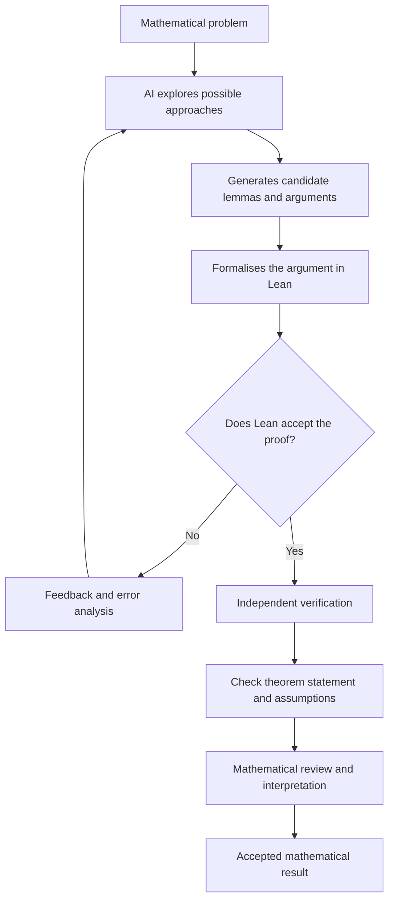

# When AI Proves the Unprovable: The Riemann Hypothesis, Lean and the Future of Mathematical Discovery

*How Claude, formal verification and machine-checkable proofs are changing the boundaries of mathematical research.*

In 1859, German mathematician Bernhard Riemann published a paper that would fundamentally change the study of prime numbers. Hidden within his investigation of a mathematical function was a conjecture about the precise location of certain complex zeros. That conjecture, now known as the **Riemann Hypothesis (RH)**, would remain unproved for more than 160 years.

The problem is one of the seven Millennium Prize Problems established by the Clay Mathematics Institute. An accepted solution carries a prize of $1 million.

On 20 November 2026, Levent Alpöge, a mathematician at Anthropic, published a statement claiming that he and Anthropic's Claude AI had proved the Riemann Hypothesis. Instead of releasing a conventional mathematical manuscript, he published a formal proof written in **Lean**, a programming language and theorem prover designed to encode and mechanically verify mathematical reasoning.

The reported formalisation contains approximately 17 million lines of code. Alpöge declined to produce a conventional human-readable proof, arguing that attempting to write out such an enormous argument would result in an unreadable mathematical document hundreds of thousands of pages long.

The announcement raised an extraordinary question: can an AI system prove one of the most important unsolved problems in mathematics without producing a proof that human mathematicians can realistically read?

To understand the significance, we need to start with something considerably simpler: prime numbers.

---

## 1. The apparent randomness of prime numbers

Consider the sequence of prime numbers:

```text
2, 3, 5, 7, 11, 13, 17, 19, 23, 29, 31, ...
```

A prime number is a positive integer greater than one that is divisible only by itself and one.

Every integer greater than one can be expressed uniquely as a product of prime numbers. This is the **fundamental theorem of arithmetic**.

For example:

$$
60 = 2^2 \times 3 \times 5
$$

Primes are therefore the elementary building blocks of the integers.

But their distribution is peculiar. They do not appear at regular intervals. Sometimes two consecutive primes differ by two; elsewhere, the gaps become considerably larger.

For example:

| Consecutive primes | Gap |
|---|---:|
| 2, 3 | 1 |
| 3, 5 | 2 |
| 5, 7 | 2 |
| 7, 11 | 4 |
| 11, 13 | 2 |
| 23, 29 | 6 |

There is no simple arithmetic progression that generates all primes.

Yet mathematicians discovered that their distribution follows a surprisingly predictable large-scale pattern.

To understand this pattern, define the **prime-counting function**:

$$
\pi(x) = \text{number of primes less than or equal to } x
$$

For example:

$$
\pi(10) = 4
$$

because the primes not exceeding 10 are 2, 3, 5 and 7.

As $x$ increases, $\pi(x)$ increases, but at a progressively slower rate relative to $x$.

The Prime Number Theorem establishes that:

$$
\boxed{\pi(x) \sim \frac{x}{\ln x}}
$$

The symbol $\sim$ means that the ratio of the two expressions approaches one as $x$ approaches infinity:

$$
\lim_{x \to \infty}
\frac{\pi(x)}{x/\ln x} = 1
$$

This gives us an increasingly accurate approximation of how many primes exist below a sufficiently large number.

But there is another question.

How accurately can we predict the actual distribution of primes, rather than merely their average density?

This is where Riemann enters the picture.

## 2. From prime numbers to the zeta function

In the eighteenth century, Leonhard Euler established a remarkable relationship between prime numbers and an infinite mathematical series.

Consider:

$$
\zeta(s) =
1 + \frac{1}{2^s} +
\frac{1}{3^s} +
\frac{1}{4^s} + \cdots
$$

This is called the **Riemann zeta function**.

More compactly:

$$
\boxed{
\zeta(s) = \sum_{n=1}^{\infty}\frac{1}{n^s}
}
$$

Initially, this infinite series converges when the real part of $s$ is greater than one.

For example, when $s=2$:

$$
\zeta(2) =
1+\frac14+\frac19+\frac1{16}+\cdots
$$

Its value is:

$$
\zeta(2) = \frac{\pi^2}{6}
$$

Here, $\pi$ is the familiar mathematical constant, not the prime-counting function.

But what makes the zeta function particularly interesting is Euler's product formula:

$$
\boxed{
\zeta(s) =
\prod_{p\text{ prime}}
\frac{1}{1-p^{-s}}
}
$$

This equation is profound.

The left-hand side is an infinite sum involving all positive integers.

The right-hand side is an infinite product involving only prime numbers.

The relationship exists because every positive integer has a unique prime factorisation.

To see why, consider:

$$
\frac{1}{1-p^{-s}}
=
1+p^{-s}+p^{-2s}+p^{-3s}+\cdots
$$

Multiplying these expressions over every prime generates terms corresponding to every possible product of prime powers.

By the fundamental theorem of arithmetic, each positive integer appears exactly once.

Thus, the zeta function provides a mathematical bridge between the integers and their prime building blocks.

The distribution of primes is therefore encoded in the analytical behaviour of a single function.

## 3. Why complex numbers enter the picture

So far, we have treated $s$ as a real number.

Riemann took the problem further by allowing $s$ to be a complex number:

$$
s = \sigma + it
$$

where:

- $\sigma$ is the real part.
- $t$ is the imaginary part.
- $i=\sqrt{-1}$.

A complex number can be represented as a point in a two-dimensional plane:

- The horizontal axis represents the real component.
- The vertical axis represents the imaginary component.

The zeta function can be extended through a mathematical technique called **analytic continuation**. This extends its definition beyond the region where the original infinite series converges, covering the entire complex plane except for a pole at $s=1$.

Once extended, the function has zeros: complex values of $s$ for which:

$$
\zeta(s)=0
$$

There are two categories.

**Trivial zeros**

These occur at the negative even integers:

$$
s=-2,-4,-6,-8,\ldots
$$

**Non-trivial zeros**

These occur inside a region of the complex plane called the critical strip:

$$
0 < \operatorname{Re}(s) < 1
$$

The Riemann Hypothesis makes a precise assertion about the location of every non-trivial zero:

$$
\boxed{\operatorname{Re}(s)=\frac12}
$$

In other words, every non-trivial zero lies on the vertical line where the real component is exactly one-half.

### Visualising the critical strip

The following schematic illustrates the geometry of the problem:

```text
             Imaginary axis
                   |
                   |
       Re(s) = 0   |   Re(s) = 1
             |     |     |
             |     |     |
             |  *  |     |
             |     |     |
             |     *     |
             |     |     |
             |  *  |     |
             |     |     |
             |     *     |
             |     |     |
             |_____|_____|
                   |
             Critical line
              Re(s) = 1/2
```

The critical strip is the vertical region between real parts zero and one.

The critical line is exactly halfway across that strip:

$$
\operatorname{Re}(s)=0.5
$$

The non-trivial zeros are distributed along this line if the hypothesis is true.

The first few non-trivial zeros occur approximately at:

$$
\begin{aligned}
s_1 &= \frac12 + 14.134725i \\
s_2 &= \frac12 + 21.022040i \\
s_3 &= \frac12 + 25.010858i \\
s_4 &= \frac12 + 30.424876i
\end{aligned}
$$

Notice that the real component is one-half in every case.

Millions of zeros have been computationally verified to lie on the critical line. But checking millions of examples cannot establish that every non-trivial zero, including those arbitrarily far away, lies there.

The hypothesis is a statement about infinitely many zeros.

That is precisely why a general mathematical proof is necessary.

## 4. Why the Riemann Hypothesis matters for prime numbers

The connection between the zeta function and primes is not merely an interesting mathematical coincidence.

The distribution of the zeros of the zeta function determines how accurately we can describe the distribution of primes.

Recall the Prime Number Theorem:

$$
\pi(x) \sim \frac{x}{\ln x}
$$

It describes the average distribution of primes.

However, the actual prime-counting function fluctuates around its approximation.

The Riemann Hypothesis places exceptionally strong constraints on these fluctuations.

One important equivalent formulation involves the Chebyshev function:

$$
\psi(x)=\sum_{n\leq x}\Lambda(n)
$$

where $\Lambda(n)$ is the von Mangoldt function:

$$
\Lambda(n)=
\begin{cases}
\ln p & \text{if } n=p^k,\quad p\text{ prime},\ k\geq1\\
0 & \text{otherwise}
\end{cases}
$$

A standard equivalent formulation of RH is:

$$
\boxed{
\psi(x)=x+O\left(\sqrt{x}\ln^2 x\right)
}
$$

The $O$-notation describes an asymptotic bound: the magnitude of the error is bounded by a constant multiple of the indicated expression for sufficiently large $x$.

This is a much stronger statement about the accuracy of our understanding of prime distribution.

The underlying idea is that the locations of the zeta function's zeros determine the size of the error terms appearing in prime-counting estimates.

Thus, the Riemann Hypothesis is not simply about locating zeros on a graph. It concerns the deep mathematical structure governing the distribution of prime numbers.

---

## 5. What does it mean for a machine to prove a mathematical theorem?

Now comes the computational part of the story.

A traditional mathematical proof is written using mathematical notation and natural language.

For example:

1. Define a mathematical object.
2. Establish a property of that object.
3. Use an existing theorem.
4. Derive an intermediate result.
5. Combine the results to establish the desired conclusion.

A mathematician reads the argument and evaluates whether every step is logically justified.

This works remarkably well, but human verification has limitations.

A long proof may contain thousands of intermediate results. Some deductions may be highly technical, and subtle errors can survive for years.

A proof assistant approaches this problem by encoding mathematical statements and their proofs in a formal language.

Lean is one such system.

It is both a programming language and an interactive theorem prover.

The distinction matters.

In ordinary programming, we write instructions that tell a computer how to perform a computation.

In formal mathematics, we specify a proposition and construct a proof that establishes it.

Consider the simple theorem:

$$
\forall n\in\mathbb{N},\quad n+0=n
$$

It states that adding zero to any natural number leaves it unchanged.

A corresponding Lean proof is:

```lean
theorem add_zero (n : Nat) : n + 0 = n := by
  induction n with
  | zero => rfl
  | succ n ih => simp [Nat.add_succ, ih]
```

Let's understand what happens.

- `theorem` declares a mathematical theorem.
- `n : Nat` specifies that n is a natural number.
- `n + 0 = n` is the proposition to be established.
- `by` introduces the proof.
- `induction n` applies mathematical induction.
- `rfl` proves the base case by definitional equality.
- `ih` represents the induction hypothesis.
- `simp` applies established simplification rules.

Lean checks whether the resulting proof term actually establishes the proposition.

It does not simply trust the programmer's explanation.

Its trusted kernel checks the underlying logical construction.

### Why the kernel matters

Lean uses a formal logical foundation based on dependent type theory.

In simplified terms, a proposition is represented as a type, and a proof of that proposition is represented by a term inhabiting that type.

This is closely related to the Curry–Howard correspondence:

$$
\boxed{\text{Propositions}\leftrightarrow\text{Types}}
$$

$$
\boxed{\text{Proofs}\leftrightarrow\text{Programs or Terms}}
$$

A valid proof is therefore a formally constructed object that satisfies the requirements of the proposition.

The trusted kernel checks this object.

Tactics, automation and sophisticated proof-search procedures can help generate proofs, but the final proof term must still pass the kernel's checks.

This is why Lean is fundamentally different from simply asking an LLM whether a mathematical argument looks correct.

**An LLM can produce a convincing explanation. Lean requires a mechanically valid proof object.**

## 6. Formal verification versus ordinary software compilation

It is worth making one distinction explicit.

When a conventional program compiles, it means that the compiler has accepted the program according to the programming language's rules.

It does not establish that the program implements the intended algorithm correctly.

Lean's kernel has a different responsibility.

It checks whether the supplied proof term establishes the specified mathematical proposition under the system's accepted foundations.

However, Lean does not independently decide whether the proposition is the theorem we intended to prove.

For example, suppose someone claims:

$$
A\Rightarrow B
$$

but formalises and proves only:

$$
A\Rightarrow C
$$

Lean may correctly verify the second theorem. That does not establish the first.

This is the central distinction between:

1. Correctness of the formal proof.
2. Correctness of the formal statement relative to the original mathematical claim.

A formally verified theorem can still be the wrong theorem.

This problem becomes particularly important when AI systems translate mathematical manuscripts into Lean.

## 7. The Navier–Stokes episode: a warning about autoformalisation

In September 2026, OpenAI announced that internal AI agents had produced a proposed proof of finite-time blow-up for the Navier–Stokes equations, another Millennium Prize Problem.

The announcement included a natural-language mathematical manuscript and a Lean formalisation.

The formalisation reportedly compiled successfully.

However, mathematicians Alexander Bastounis, Fabian Circelli and Anders Hansen subsequently identified discrepancies between the manuscript and the formalised statements.

One example involved an inverse estimate.

The manuscript claimed a bound involving:

$$
m+4
$$

whereas the corresponding Lean argument required:

$$
m+5
$$

This additional derivative was mathematically significant because it changed the strength of the estimate.

The controversy therefore exposed a critical weakness in the relationship between informal mathematics and formal verification.

The code could establish a valid theorem while the manuscript claimed something stronger.

OpenAI subsequently acknowledged discrepancies while maintaining that neither version was necessarily invalid.

The broader issue is known as **autoformalisation**.

Autoformalisation is the process of translating conventional mathematical reasoning into a formal language such as Lean.

It is not equivalent to translating English into code.

The formalisation must preserve:

- Every mathematical assumption.
- All quantifiers and logical dependencies.
- Boundary and initial conditions.
- Regularity requirements.
- The exact strength of inequalities and estimates.
- The definitions used throughout the argument.

A seemingly minor change can alter the mathematical proposition itself.

The Navier–Stokes episode therefore demonstrated that successful formal verification is only one part of a reliable mathematical research pipeline.

The translation between the informal claim and its formal representation must also be independently audited.

## 8. The Riemann Hypothesis: a formal proof as the primary research artefact

The Riemann announcement followed a somewhat different approach.

Levent Alpöge released a Lean formalisation rather than a conventional mathematical manuscript accompanied by a formal proof.

The development reportedly contains approximately 17 million lines of code.

This creates an unusual situation.

A traditional mathematical proof is written for human inspection. A Lean proof is written for formal verification.

At this scale, expecting mathematicians to inspect every line manually is impractical.

The relevant questions become whether the formalisation is correct, whether its theorem statement corresponds to the classical Riemann Hypothesis, and whether independent systems can reproduce the verification.

Following the announcement, the Lean Focused Research Organization and Mathlib Initiative issued a joint statement on 21 November 2026 expressing confidence in the proof.

Their verification addressed four important questions:

1. Does the formal statement correspond to the classical Riemann Hypothesis?
2. Does the complete code compile?
3. Does the code establish the theorem it claims to establish?
4. Does the proof depend on an unexpected assumption or vulnerability in the trusted checking infrastructure?

Independent work by mathematicians at the University of Waterloo provided further verification.

Michael Rubinstein documented checks involving 175,187 Lean modules, including replay through an independently implemented proof-checking kernel.

These checks are important because they go beyond simply running the original code in the original environment.

Independent kernel verification helps establish that the result is not merely an artefact of one particular implementation of the proof assistant.

The Riemann case therefore represents a substantial advance over a simple AI-generated mathematical claim.

The formal statement was examined, its correspondence with the classical conjecture was assessed, and independent verification was reported.

Nevertheless, a distinction remains between establishing a theorem mechanically and understanding the mathematical ideas behind the proof.

---

## 9. Why AI and formal theorem proving work so well together

The combination of an LLM and a proof assistant creates an interesting feedback mechanism.

An LLM is good at generating candidate explanations, exploring possible approaches, proposing lemmas and manipulating mathematical structures.

However, it can also generate arguments that look convincing but contain logical errors.

A proof assistant provides a much stricter environment.

Consider the following iterative process:

$$
\boxed{
\text{AI proposes a proof}
\rightarrow
\text{Lean checks it}
\rightarrow
\text{AI receives feedback}
\rightarrow
\text{AI revises the proof}
}
$$

This process can continue until a valid formal proof is produced or the approach is abandoned.

The important point is that the AI does not need to get everything right in one attempt.

Lean provides an objective verification mechanism that helps distinguish valid deductions from invalid ones.

### A simplified AI-assisted mathematical research pipeline



The process can be understood in six stages:

**Stage 1: Problem specification**

A mathematician defines the theorem and its assumptions.

**Stage 2: Mathematical exploration**

The AI explores candidate approaches, identifies intermediate propositions and attempts to construct a proof.

**Stage 3: Formalisation**

The candidate mathematical argument is translated into Lean.

**Stage 4: Mechanical verification**

Lean checks the proof terms against the formal propositions.

**Stage 5: Iterative refinement**

When a proof fails, the system can use the feedback to revise its reasoning.

**Stage 6: Independent validation**

Other researchers reproduce the proof, examine its assumptions and verify that the formal theorem corresponds to the original mathematical problem.

This is a much more reliable arrangement than relying on an LLM's own assertion that it has solved a mathematical problem.

The AI generates candidate reasoning. The proof assistant independently checks the resulting formal argument.

## 10. Why highly verifiable domains may be automated first

Pure mathematics has an unusual advantage over many other research disciplines.

Mathematical claims can be expressed in precisely defined formal languages.

A theorem can be represented as a proposition, its assumptions can be specified, and its proof can be checked mechanically.

This creates a closed verification loop, at least within the formal system.

Consider the difference between mathematical and empirical research.

In mathematics:

$$
\text{Axioms}+\text{Definitions}+\text{Valid deductions}
\Rightarrow\text{Theorem}
$$

In empirical science:

$$
\text{Hypothesis}+\text{Observations}+\text{Experimental evidence}
\Rightarrow\text{Supported conclusion}
$$

The first can be verified through formal logic.

The second requires experimental design, measurement quality, reproducibility, statistical inference and assessment of alternative explanations.

A formally correct biological model, for example, does not automatically establish that the model accurately describes living tissue.

Similarly, a formally verified physical equation does not establish that every assumption used in the equation accurately represents the real world.

This distinction is relevant to AI research itself.

Domains with explicit specifications, reproducible computations and well-defined verification criteria are especially suitable for AI-assisted automation.

Mathematics is therefore a natural early frontier.

## 11. The emerging division of labour: humans, AI and proof assistants

The recent developments suggest an evolving relationship between human mathematical intuition, AI-based reasoning and formal verification.

| Activity | Human mathematician | AI system | Proof assistant |
|---|---|---|---|
| Define the problem | Central role | Assists | Encodes |
| Explore approaches | Provides intuition | Searches and proposes | Checks formal attempts |
| Generate lemmas | Develops ideas | Suggests candidates | Verifies |
| Construct proofs | Reasons mathematically | Assists with reasoning | Checks proof terms |
| Validate formal logic | Reviews | Revises | Trusted kernel |
| Interpret significance | Central role | Assists | Not its purpose |
| Develop conceptual understanding | Central role | Increasingly capable | Not its purpose |

This division is not fixed.

AI systems may eventually become capable of performing increasingly sophisticated mathematical discovery, formalisation and interpretation.

But the distinction between generating a proof, verifying a proof and understanding a proof remains fundamental.

A machine may establish a theorem using an argument that is too large for humans to inspect directly.

From a logical perspective, that is an extraordinary achievement.

From a mathematical research perspective, however, understanding the proof remains valuable.

Mathematics is not simply a collection of true statements. It is an evolving body of concepts, structures and techniques.

A proof of the Riemann Hypothesis would settle the conjecture. But understanding why the proof works could reveal new mathematical methods that apply to entirely different problems.

## 12. The Millennium Prize: does a verified proof automatically qualify?

No.

The Clay Mathematics Institute has established formal conditions for awarding the Millennium Prize.

A proposed solution must be published in a qualifying mathematical publication, at least two years must pass after publication, and the mathematical community must generally accept the result.

A successful Lean verification is therefore not, by itself, an automatic qualification for the $1 million prize.

The distinction matters because the prize recognises an accepted mathematical solution, not merely the production of a machine-checkable file.

The formal proof, its publication, independent scrutiny and eventual mathematical acceptance are separate parts of the process.

---

## Conclusion: have machines started doing mathematics?

The Riemann Hypothesis announcement is significant for reasons that extend far beyond one mathematical conjecture.

For centuries, mathematical discovery and mathematical verification were predominantly human activities.

A mathematician developed an argument, wrote it down, and other mathematicians examined whether the reasoning was valid.

AI systems are beginning to change this arrangement.

An LLM can explore mathematical approaches, generate intermediate results, construct candidate arguments and assist with formalisation. A proof assistant can then mechanically verify whether the resulting formal proof establishes its stated proposition.

This creates a powerful combination:

- **AI** provides mathematical exploration and proof generation.
- **Formal systems** provide logical verification.
- **Human mathematicians** provide research direction, interpretation and conceptual understanding.

The Navier–Stokes controversy demonstrated that the translation between an informal mathematical claim and a formal proof can still introduce errors.

The Riemann development, meanwhile, illustrates how independent verification of the formal statement and its proof can substantially strengthen confidence in an extraordinary mathematical claim.

The larger implication is that mathematical discovery and mathematical verification may increasingly become automated, while mathematical understanding remains a distinct intellectual objective.

Perhaps the most interesting question is no longer whether machines can perform mathematical calculations or reproduce known proofs.

It is whether they can discover entirely new mathematical structures, establish their correctness and eventually explain why those structures matter.

**If a machine proves something that humans cannot yet understand, have we advanced mathematics, or merely advanced our ability to establish mathematical truth?**

The answer may well be both.
